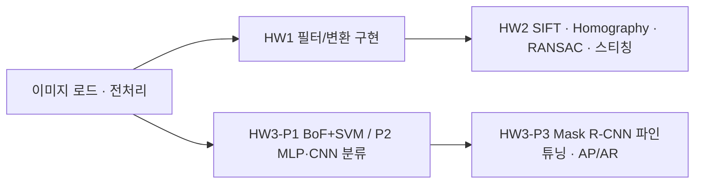
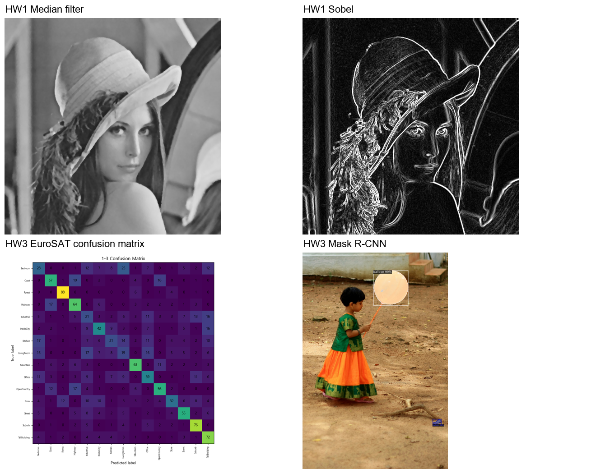

# 컴퓨터비전 과제 — 이미지 처리 · Homography · EuroSAT 분류 · Mask R-CNN

2025.03 – 2025.06 · 성균관대학교 정보통신대학원 컴퓨터비전 과목 · 개인 과제 3건 (코드·보고서 직접 작성)

## 프로젝트 소개

컴퓨터비전 수업(2025-1학기)에서 수행한 과제 3건의 코드와 결과 이미지입니다. 고전 기법(기하 변환, 필터링, SIFT, Homography/RANSAC)에서 딥러닝(MLP·CNN 분류, Detectron2 Mask R-CNN 파인튜닝)까지 같은 과제 흐름 안에서 직접 구현하고 비교했습니다. 과제 외에 논문 발표(*Hierarchical Fine-Grained Image Forgery Detection and Localization*)도 수행했으나 이 레포에는 포함하지 않았습니다.

## 문제 정의

| 과제 | 주제 | 수행 내용 |
|---|---|---|
| HW1 | 이미지 변환·필터링 | 이동·회전·Affine·Perspective 변환행렬 직접 구성, Gaussian·Sobel·Laplacian 비교, 리사이즈 보간법 비교, Gaussian/Laplacian 피라미드 복원, **Median Filter 직접 구현**(OpenCV 결과와 비교) |
| HW2 | 특징 디스크립터·Homography | 패치 추출, SIFT 디스크립터, BFMatcher 매칭, Homography 추정에서 **RANSAC vs Least Squares 비교**, 이미지 스티칭, **RANSAC 직접 구현** |
| HW3-P1 | 이미지 분류 (고전) | Bag-of-Features(SIFT + KMeans K=20) + Linear SVM, SCENE-15 데이터셋 |
| HW3-P2 | 이미지 분류 (딥러닝) | MLP와 CNN을 **EuroSAT**(위성영상 10클래스, 27,000장)에 적용, 100 epoch 학습 |
| HW3-P3 | 인스턴스 분할 | Detectron2 **Mask R-CNN**(R50-FPN, COCO 사전학습) 파인튜닝(balloon 데이터셋), COCOEvaluator로 AP/AR 평가, 하이퍼파라미터 개선 제안 |

## 데이터

| 데이터 | 출처 | 규모 | 레포 포함 여부 |
|---|---|---|---|
| EuroSAT | 공개 데이터셋 (Helber et al.) — https://github.com/phelber/EuroSAT | 10클래스 약 27,000장 | **미포함**. 내려받아 `hw3/EuroSAT/2750/`에 압축 해제 (`p2_mlp_cnn_eurosat.py`의 `get_EuroSAT('EuroSAT')`가 자동 다운로드도 시도) |
| SCENE-15 | 수업 제공 (15개 장면 클래스) | train/test 폴더 | **미포함**. `hw3/data/SCENE-15/{train,test}/<클래스>/` 에 배치 |
| balloon | Detectron2 튜토리얼 공개 데이터셋 | train/val + `via_region_data.json` | **미포함**. 노트북(Colab)에서 `/content/balloon/` 경로 사용 |
| lenna, paired_images | 수업 제공 입력 이미지 | 소량 | **미포함** (저작권·용량). `hw1/lenna/lenna.png`, `hw2/paired_images/` 에 배치 |

원천 데이터는 모두 공개/수업 자료이며 레포에는 코드와 **결과 이미지만** 포함했습니다. 샘플 데이터는 두지 않았습니다 (이미지 입력이라 난수 샘플이 의미가 없음).

## 분석 방법



1. **HW1** — OpenCV `warpAffine`/`warpPerspective`로 변환, 커널 필터 비교, 소금-후추 노이즈 생성 후 Gaussian vs Median 비교, 3×3 Median Filter를 NumPy로 직접 구현하고 `cv2.medianBlur`와 MSE 비교
2. **HW2** — 32×32 stride 32 패치 추출(1-1) → SIFT 디스크립터·히스토그램(1-2) → BFMatcher 매칭(1-3/1-4) → `cv2.findHomography`의 RANSAC vs Least Squares로 스티칭 비교(2) → RANSAC을 직접 구현해 스티칭(3)
3. **HW3-P1** — 16px stride 격자 키포인트에서 SIFT 추출 → KMeans(K=20) 코드북 → 히스토그램 인코딩 → LinearSVC 분류, 혼동행렬
4. **HW3-P2** — 32×32 리사이즈, train/val/test 분할, MLP와 CNN 모델 정의, Adam(lr 0.001), batch 64, 100 epoch, 테스트 혼동행렬
5. **HW3-P3** — `mask_rcnn_R_50_FPN_3x` 사전학습 모델로 추론(3-1) → balloon으로 파인튜닝(IMS_PER_BATCH 2, LR 0.00025, 300 iter)(3-2) → COCOEvaluator AP/AR(3-3) → 하이퍼파라미터 개선안(3-4)

## 기술 스택

Python, PyTorch, torchvision, Detectron2 (Colab), OpenCV, NumPy, scikit-learn, matplotlib/seaborn

## 결과

| 과제 | 지표 | 결과 |
|---|---|---|
| HW1 | 직접 구현 Median Filter vs OpenCV `medianBlur` MSE | **0.5277** |
| HW2 | 스티칭 결과 이미지 | RANSAC vs Least Squares 비교, 직접 구현 RANSAC 스티칭 (`hw2/results/result_2`, `result_3`) |
| HW3-P2 | EuroSAT 테스트 정확도 (CNN) | **82.46%** |
| HW3-P3 | Mask R-CNN AP/AR | COCOEvaluator 리포트 (`hw3/results/p3_mask_rcnn/`) |



결과 이미지 폴더
- `hw1/results/q1_transforms` (변환), `q2_filters` (필터·노이즈), `q3_resize_pyramid` (보간·피라미드), `q4_median_filter` (직접 구현 vs OpenCV)
- `hw2/results/result_1-3`, `result_1-4` (매칭), `result_2` (RANSAC vs Least Squares 스티칭), `result_3` (직접 구현 RANSAC, `*_before_fix`는 수정 전). 패치 조각(`result_1-1` 713장, `result_1-2` 280장)은 샘플만 포함
- `hw3/results/p1_bof_svm` (혼동행렬·인코딩 히스토그램), `p2_mlp_cnn` (테스트 혼동행렬), `p3_mask_rcnn` (추론·파인튜닝 시각화)

## 실행 방법

```bash
pip install -r requirements.txt     # torch/torchvision은 CUDA 버전에 맞게 설치

# HW1 (hw1/ 폴더에서, lenna/lenna.png 필요)
cd hw1 && python hw1_filters_transforms.py

# HW2 (hw2/ 폴더에서, paired_images/ 필요)
cd hw2 && python hw2_sift_homography_stitching.py

# HW3
cd hw3
python p1_bof_svm_scene15.py        # data/SCENE-15/ 필요
python p2_mlp_cnn_eurosat.py        # EuroSAT/2750/ 자동 다운로드 또는 수동 배치
# p3_mask_rcnn_detectron2.ipynb 는 Google Colab(GPU)에서 실행 — 첫 셀에서 detectron2 설치
```

- 각 스크립트 상단의 `os.chdir("E://김민서//...")` 하드코딩 경로는 **환경에 맞게 수정하거나 주석 처리**하세요 (해당 폴더에서 직접 실행하면 주석 처리만으로 동작).
- `p1_bof_svm_scene15.py`는 한글 폰트 경로 `C:/Windows/Fonts/malgun.ttf`를 사용합니다. 다른 OS에서는 폰트 경로를 바꾸세요.
- HW1/HW2 스크립트는 `cv2.imshow` 창을 띄우므로 GUI 환경에서 실행하세요.

## 폴더 구조

```
cv-coursework/
├── README.md
├── requirements.txt
├── hw1/
│   ├── hw1_filters_transforms.py
│   └── results/{q1_transforms,q2_filters,q3_resize_pyramid,q4_median_filter}/
├── hw2/
│   ├── hw2_sift_homography_stitching.py
│   └── results/{result_1-1_sample,result_1-2_sample,result_1-3,result_1-4,result_2,result_3}/
├── hw3/
│   ├── p1_bof_svm_scene15.py
│   ├── p2_mlp_cnn_eurosat.py
│   ├── p3_mask_rcnn_detectron2.ipynb
│   └── results/{p1_bof_svm,p2_mlp_cnn,p3_mask_rcnn}/
└── docs/images/CV_01_결과.png
```

## 참고

- Obsidian 노트: `2025-03_컴퓨터비전_과제_EuroSAT_MaskRCNN`
- 관련 레포: 한전 현장이미지 자동분류 (`2025-09_한전_현장이미지_자동분류`, 비공개 과제)
- 과제 보고서(hwp)와 과제 지시문 PDF는 수업 자료이므로 포함하지 않았습니다. 파일명·내용의 학번은 제거했습니다.
